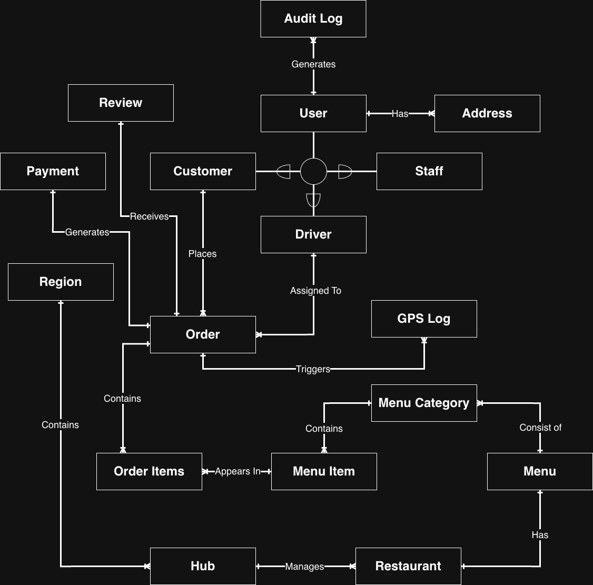
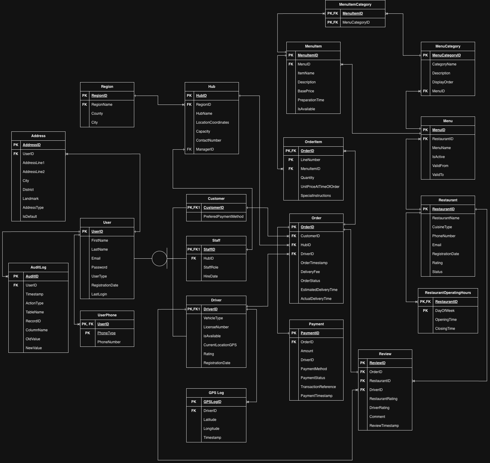
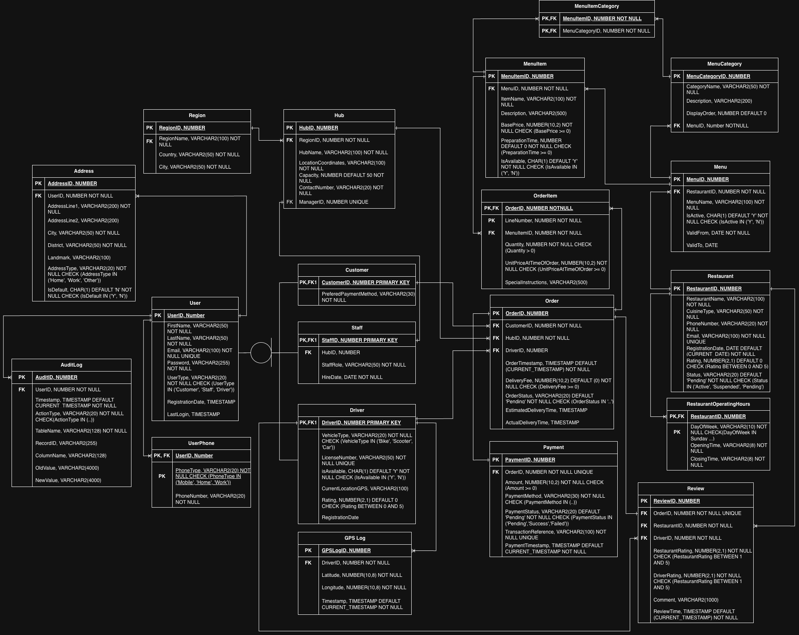

# FlashCart – Food Delivery Database

A multi-model database project for **FlashCart**, a fictional food-delivery platform
(customers, restaurants, regional hubs, drivers and orders). It was built for the
*Database Programming* course and combines a relational core with NoSQL and big-data components.

## Components

| Layer | Tech | What it covers |
|---|---|---|
| Relational core | Oracle SQL / PL/SQL | 21 tables, constraints, sample data (30 users, 3 restaurants, orders, payments, reviews) |
| Access points | Oracle | `CustomerOrderHistoryView`, `PlaceNewOrder` procedure, `IsRestaurantOpen` function |
| Performance | Oracle | `hubPerfromanceMV` materialized view, refresh procedure, benchmark vs. base-table query |
| Auditing | Oracle PL/SQL | `audit_package` (transaction/error logging), triggers on `CUSTOMER`, `DRIVER`, `REVIEW`, and a DDL trigger blocking drops of core tables |
| Document store | MongoDB (JSON) | Restaurants with nested operating hours, menu categories and items |
| Graph | Neo4j (Cypher) | Hubs and customers with `DELIVERS_TO` distances and shortest-hub lookup |
| Big data | Hive | `address_partitioned` external table partitioned by city |

## Design

| Conceptual (ERD) | Logical | Physical |
|---|---|---|
|  |  |  |

`User` is a supertype of `Customer`, `Staff` and `Driver`. Key relationships: Region → Hub, Hub → Order,
Customer → Order, Driver → Order, Order → OrderItem / Payment / Review, Restaurant → Menu → MenuItem,
and MenuItem ↔ MenuCategory (M:N).

## Repository layout

```
sql/oracle/     Oracle scripts, run in numeric order
nosql/mongodb/  restaurants.json
nosql/neo4j/    graph.cypher
bigdata/hive/   address_partitioned.hql
docs/           conceptual, logical and physical design diagrams
```

## Running the Oracle part

Run the scripts in `sql/oracle/` in order (01 → 07) in SQL*Plus, SQL Developer or SQLcl.
`01_ddl.sql` creates tables, `02_dml.sql` loads data, and the rest depend on those.

- **MongoDB:** `mongoimport --db flashcart --collection restaurants --file nosql/mongodb/restaurants.json --jsonArray`
- **Neo4j:** paste `graph.cypher` into Neo4j Browser, or run it with `cypher-shell`.
- **Hive:** run `address_partitioned.hql` and place CSV data under `/user/hive/warehouse/address_partitioned/city=<City>/`.

## Known issues / TODO

- `05_mv_refresh_and_benchmark.sql` refreshes `mv_hub_hourly_performance`, but the view is named `hubPerfromanceMV` (typo in the original name too).
- `IsRestaurantOpen` always returns 0: `TO_CHAR(..., 'Day')` is space-padded, and opening/closing times are `VARCHAR2` compared with a timestamp. Closing times after midnight are also not handled.
- The `REVIEW` trigger falls back to hard-coded admin ID `30`.
- `07_review_and_ddl_triggers.sql` test line `DROP TABLE Order;` is invalid syntax (`"Order"` needs quotes).
- Minor differences between the physical diagram and the DDL (e.g. `Review.DriverID` nullability, GPS coordinate precision).
- Sample passwords are placeholders (`hash_pass_01` …), not real hashes.

## License

Add a license of your choice before publishing.
